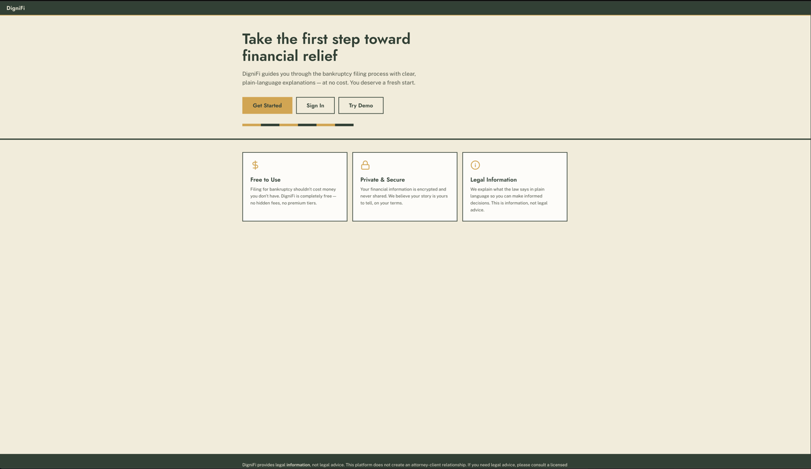

# DigniFi — Trauma-Informed Bankruptcy Filing Platform

<p align="center">
  
</p>

**Mission**: Democratize access to bankruptcy relief for low-income, pro se Americans by translating complex legal processes into plain-language guidance and auto-populated court forms.

> **CRITICAL**: This platform provides legal **INFORMATION**, never legal **ADVICE**. All development must respect UPL (Unauthorized Practice of Law) boundaries.

## Project Status

**MVP Complete & Deployed** — Full-stack application validated through AI persona testing and live on Heroku (June 2026)

|                    |                                        |
| ------------------ | -------------------------------------- |
| **Pilot District** | Northern District of Illinois (ILND)   |
| **MVP Scope**      | Chapter 7 bankruptcy filing assistance |
| **Next Milestone** | Public beta with coalition partners    |

### Test Results

| Suite                     | Count            | Status          |
| ------------------------- | ---------------- | --------------- |
| Backend (pytest)          | 2,096 (+1 xfail) | Passing         |
| Frontend (vitest)         | 358              | Passing         |
| E2E journeys (Playwright) | 7/7 journeys     | All steps green |

## Quick Start

### Prerequisites

- Docker & Docker Compose (or Colima on macOS)
- Python 3.11+ (for local development without Docker)
- Node.js 20.19+ or 22.12+ (for local development without Docker)

### Running with Docker (Recommended)

```bash
# 1. Copy environment file
cp .env.example .env

# 2. Generate encryption key
python3 -c "from cryptography.fernet import Fernet; print(Fernet.generate_key().decode())"
# Add the output to FIELD_ENCRYPTION_KEY in .env

# 3. Start services
docker compose up -d

# 4. Run migrations
docker compose exec backend python manage.py migrate

# 5. Load ILND district data
docker compose exec backend python manage.py loaddata ilnd_2025_data

# 6. Seed demo personas (optional — for testing)
docker compose exec backend python manage.py seed_demo_data

# 7. Access the application
# - Frontend: http://localhost:5173
# - Backend API: http://localhost:8000/api
# - Admin: http://localhost:8000/admin
```

### Verify Everything Works

```bash
# Backend tests
docker compose exec backend pytest -q

# Frontend tests
cd frontend && npx vitest run

# Quick persona smoke test (requires Playwright)
python3 docs/testing/test_maria_quick.py
```

### Code Quality Setup (Recommended)

Set up automatic linting and formatting before every commit:

```bash
# One-time setup
pip install pre-commit
pre-commit install
```

This installs pre-commit hooks that automatically:

- Format code with Prettier (frontend) and Black (backend)
- Lint with ESLint (frontend) and Ruff (backend)
- Fix trailing whitespace and other issues

See [CONTRIBUTING.md](CONTRIBUTING.md#code-quality--formatting) for details.

### Local Development (Without Docker)

**Backend:**

```bash
cd backend
python3 -m venv venv
source venv/bin/activate
pip install -r requirements/development.txt
cp .env.example ../.env
# Edit ../.env with your local database settings
python manage.py migrate
python manage.py runserver
```

**Frontend:**

```bash
cd frontend
npm install
npm run dev
```

## Project Structure

```text
dignifi/
├── backend/                 # Django REST API
│   ├── apps/
│   │   ├── users/          # Authentication & profiles
│   │   ├── audit/          # UPL compliance + analytics logging
│   │   ├── districts/      # District-specific rules & data
│   │   ├── intake/         # Data collection (8-step wizard)
│   │   ├── eligibility/    # Means test calculator
│   │   ├── documents/      # Document scanning pipeline (OCR → draft debts)
│   │   └── forms/          # 17 court forms: registry, fill engine, PDF filler
│   ├── config/             # Django settings (base, dev, prod)
│   └── requirements/       # Python dependencies
├── frontend/               # React 19 + TypeScript SPA
│   ├── src/
│   │   ├── components/     # UI components (wizard, forms, compliance, survey)
│   │   ├── pages/          # IntakeWizard, FormDashboard, Login, Register
│   │   ├── context/        # AuthContext, IntakeContext
│   │   ├── api/            # Typed API client
│   │   └── utils/          # Analytics, helpers
│   └── e2e/                # Playwright page objects & journey specs
├── data/forms/pdfs/        # 67 official AO court PDF templates
└── docs/                   # Reference documentation
    ├── internal/           # PRD, briefs, architecture analysis
    ├── testing/            # Persona briefs, test scripts, run protocol
    ├── reports/            # Usability test reports
    └── superpowers/        # Implementation plans and specs
```

## Technology Stack

- **Backend**: Python 3.11, Django 5.0, Django REST Framework, PostgreSQL 15
- **Frontend**: React 19, Vite 7, TypeScript (Context API for state management)
- **PDF Generation**: pypdf 6.x — 17 form schemas fill official AO court templates
- **Authentication**: JWT (djangorestframework-simplejwt) with silent refresh
- **Encryption**: django-encrypted-model-fields (Fernet) for PII
- **Testing**: pytest, vitest, Playwright, vitest-axe (accessibility)
- **CI/CD**: GitHub Actions (lint, backend tests, frontend tests, E2E)
- **Document Scanning**: OpenAI GPT-4o by default, or Gemini 2.0 Flash (chosen by `OCR_PROVIDER`; `OCR_MODEL` overrides the model), opendataloader-pdf, pymupdf
- **Infrastructure**: Docker, Docker Compose (dev); Heroku Container Stack (production)

## Core Features

- Document scanning (v2): drag-and-drop upload → OCR by the configured provider (OpenAI GPT-4o by default) → credit reports extract tradelines into debt drafts (with "From scan" badge); a pay stub fills the employer's name on Schedule I
- User authentication with JWT (access in memory, refresh in localStorage)
- 8-step intake wizard: Your Information → Income → Expenses → Assets → Amounts Owed → Contracts & Leases → Codebtors → Review & Results
- Chapter 7 means test calculator (11 U.S.C. § 707(b) — annualized CMI vs. Census median by household size)
- Fee waiver eligibility assessment (28 U.S.C. § 1930(f))
- 17 court forms (Form 101 through Schedules A/B–J); each filer's packet holds 14–16 of them
- PDF download — each form's schema fills its official AO court template via pypdf
- UPL confirmation modal gates all form generation
- Post-task usability survey (3 Likert + 2 open text)
- Fire-and-forget analytics via AuditLog API
- WCAG 2.1 AA accessibility (ARIA labels, keyboard nav, skip links)
- Trauma-informed language throughout ("amounts owed" not "debt")

## Development Guidelines

### UPL Compliance (CRITICAL)

**Never use these phrases:**

- "You should file Chapter 7"
- "I recommend..."
- "Based on your situation, file X"

**Always use information-only language:**

- "You may be eligible for Chapter 7 if..."
- "Chapter 7 typically requires..."
- "This information is not legal advice"

See `docs/UPL_COMPLIANCE.md` for complete guidelines.

### Plain Language

- Target 6th-8th grade reading level (Flesch-Kincaid)
- Define legal terms on first use
- Use trauma-informed language (see `docs/TRAUMA_INFORMED_DESIGN.md`)

### Data Security

- **Encrypt all PII** (SSN, income data, creditor information)
- Never log PII in error messages
- Use HTTPS in production
- JWT access tokens expire after 30 minutes
- Synthetic SSNs for testing use IRS-reserved 900-xx range

## Testing

```bash
# Backend (2,096 tests + 1 xfail)
docker compose exec backend pytest -q

# Frontend (358 tests)
cd frontend && npx vitest run

# Full E2E (7 Playwright journeys; backend running and seeded)
cd frontend && npm run e2e

# Quick smoke test (Maria only)
python3 docs/testing/test_maria_quick.py
```

## API Documentation

Key endpoints:

| Method | Path                                              | Description                             |
| ------ | ------------------------------------------------- | --------------------------------------- |
| POST   | `/api/token/obtain/`                              | JWT login                               |
| POST   | `/api/token/refresh/`                             | Refresh access token                    |
| POST   | `/api/intake/sessions/`                           | Create intake session                   |
| PATCH  | `/api/intake/sessions/{id}/`                      | Update session data (nested serializer) |
| POST   | `/api/intake/sessions/{id}/complete/`             | Finalize intake                         |
| POST   | `/api/intake/sessions/{id}/calculate_means_test/` | Run means test                          |
| POST   | `/api/forms/generate_all/`                        | Generate every form in the packet       |
| GET    | `/api/forms/?session={id}`                        | List generated forms                    |

## Contributing

1. Review `docs/UPL_COMPLIANCE.md` — UPL boundaries are non-negotiable
2. Follow plain-language guidelines (`docs/PLAIN_LANGUAGE_GUIDE.md`)
3. Use trauma-informed design principles (`docs/TRAUMA_INFORMED_DESIGN.md`)
4. Open PRs against `develop`; `develop` is promoted to `main`, and `main` to `prod`, by fast-forward (see `CONTRIBUTING.md`)
5. All PRs must pass CI (lint, security scan, backend tests, frontend tests, E2E)
6. Keep backend coverage at 90%+ (CI fails below it)

## Deployment

**Production checklist:**

- [ ] Generate new `DJANGO_SECRET_KEY`
- [ ] Generate new `FIELD_ENCRYPTION_KEY`
- [ ] Set `DEBUG=False`
- [ ] Configure HTTPS/SSL
- [ ] Set up database backups
- [ ] Configure email service
- [ ] Review security settings in `config/settings/production.py`

Production runs on Heroku from the `prod` branch. A deploy fast-forwards `prod` to `main`, then runs `git push heroku prod:main`. Only the owner deploys.

## License

This project is licensed under the [Elastic License 2.0 (ELv2)](LICENSE).

You may use, modify, and distribute it freely. You may not offer it as a managed service to third parties. See `LICENSE` for full terms.

## Contact

**Project Lead**: Courtney Richardson
**Organization**: DigniFi (Social Impact Startup)

---

**Legal Disclaimer**: This software provides legal information only and does not constitute legal advice. Users should consult a licensed attorney for legal advice specific to their situation.
